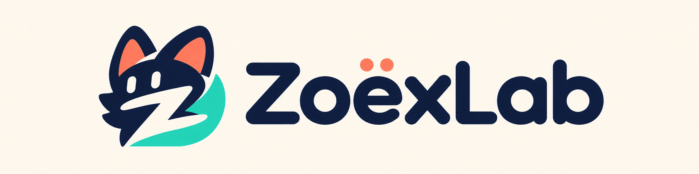

  

    <picture>
      
    </picture>
  

  

  ## **About ZoëxLab**

  歡迎來到 **ZoëxLab**！這是一個專注於 Furry 文化的個人獨立開發團隊。

  身為一名喜歡研究有趣技術的程序猿，我總想著怎麼把這些東西帶進 Furry 裡，慢慢做成實際用得到的產品或作品。

  從一開始的點子、動手做出原型，到最後正式上線，希望能做出兼具創意與實用性的數位產品和互動體驗。

  

  

  ## **Tech Stack**

  

    <a href="https://skillicons.dev">
      <picture>
        <source media="(prefers-color-scheme: dark)" srcset="https://skillicons.dev/icons?i=raspberrypi,c,cpp,arduino,js,ts,react,nextjs,vue,tailwind,nodejs,py,fastapi,rust,docker&perline=10&theme=dark">
        <source media="(prefers-color-scheme: light)" srcset="https://skillicons.dev/icons?i=raspberrypi,c,cpp,arduino,js,ts,react,nextjs,vue,tailwind,nodejs,py,fastapi,rust,docker&perline=10&theme=light">
        
      </picture>
    </a>
  
  

  

  

    
  ##  **Current Projects**

  

    
    <strong>電子獸牌｜把螢幕戴在胸前的智慧獸牌</strong> <code>🔧 開發中</code>  
    傳統獸牌只能印一張圖，我想試試看能不能讓它「動」起來。這是一款專為獸展與聚會設計的電子獸牌，除了能隨時切換角色立繪與動態畫面，還加入了靠近感應交換名片、集章互動與現場安全提醒功能。目前硬體與系統正在持續打磨中！
  

  
  

  

  ## **Contact**

  對專案有興趣、想交流想法，或是單純想打個招呼，都歡迎聯繫我：

  **網站**： <code>暫無</code>

  **Email**： <code>暫無</code>

  **組織 Github**：[Github Org](https://github.com/Zoexlab)

  

---

**@ZoëxLab ·** *Small lab, big curiosity.*

